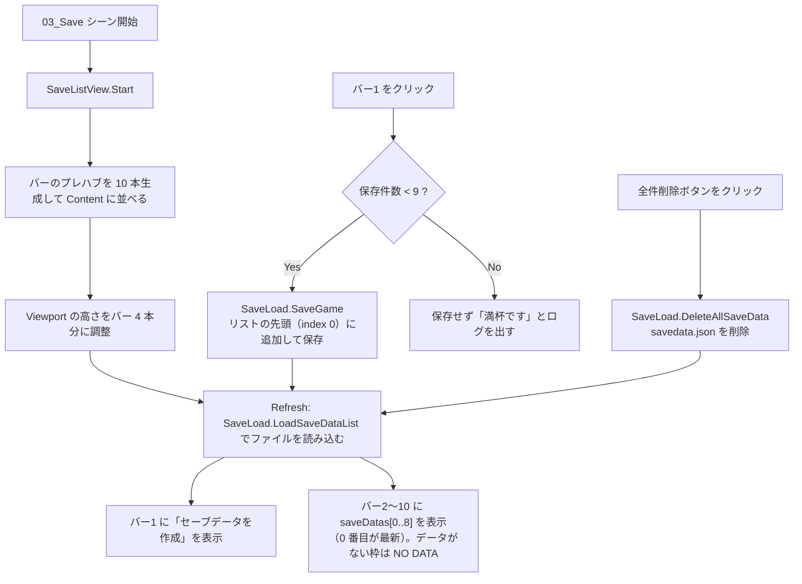
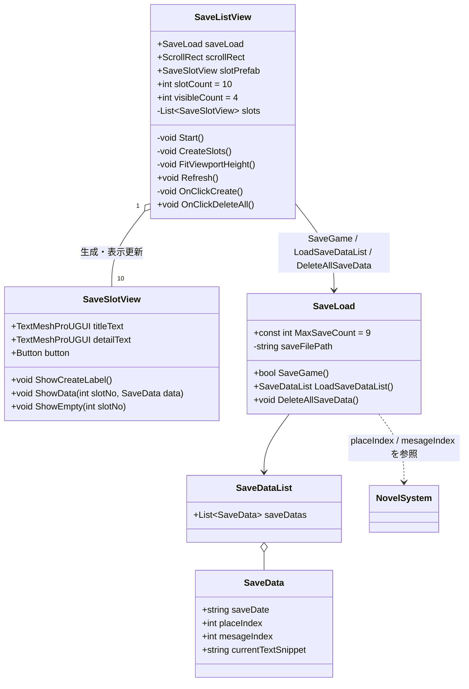

# 設計書：セーブ画面のスロット表示（スクロールリスト化）

> 改訂 2：確認事項への回答を反映（満杯時は保存しない／最新のセーブをバー2 に追加して古いものを下にずらす／全件削除ボタンを追加）

## 1. 概要
- 目的：03_Save 画面を、縦スクロールできる 10 本のセーブバーのリストにする
  - バー 1：「セーブデータを作成」ボタン。押すと `SaveGame()` を呼ぶ
  - バー 2〜10：既存のセーブデータ（日時と本文の冒頭）を表示する。データがない枠は「NO DATA」と表示する
  - 新しく作ったセーブは**常にバー 2 に入り、それまでのデータは 1 つずつ下にずれる**（最新が一番上）
  - 9 件が埋まっているときは保存せず、ログで知らせる
  - 画面中央に配置し、一度に表示するのは 4 本
  - 画面右下に「全件削除」ボタンを置き、押すとセーブデータをすべて削除する
- 対象シーン：03_Save
- 前提・制約：
  - セーブデータは今と同じ `persistentDataPath/savedata.json`（`SaveDataList`）を使う
  - 保存できるのは最大 9 件（バー 2〜10）
  - 進行状況は今と同じく `NovelSystem.placeIndex / mesageIndex`（static）から取得する

## 2. 処理の流れ

### 追加のイメージ（例：A → B → C の順にセーブ）

| バー | 1 回目の後 | 2 回目の後 | 3 回目の後 |
|---|---|---|---|
| 2 | A | B | C |
| 3 | NO DATA | A | B |
| 4 | NO DATA | NO DATA | A |

## 3. クラス構成

## 4. 追加・変更一覧

### クラス
| 区分 | クラス名 | ファイル | 機能 |
|---|---|---|---|
| 追加 | `SaveListView` | `Assets/AppMain/03_Save/Scripts/SaveListView.cs` | バーを 10 本生成し、表示の更新、バー1 と全件削除ボタンのクリック処理を担当する |
| 追加 | `SaveSlotView` | `Assets/AppMain/03_Save/Scripts/SaveSlotView.cs` | バー 1 本分の表示（作成ボタン / データ / 空き）を切り替える |
| 変更 | `SaveLoad` | `Assets/AppMain/03_Save/Scripts/Save.cs` | 読み込み処理の切り出し、先頭への追加、9 件の上限、全件削除、本文切り出し時のエラー対策 |

### 関数
| 区分 | クラス名 | 関数名（シグネチャ） | 機能 |
|---|---|---|---|
| 追加 | SaveListView | `void Start()` | `CreateSlots()` → `FitViewportHeight()` → `Refresh()` |
| 追加 | SaveListView | `void CreateSlots()` | `slotPrefab` を `slotCount` 本、ScrollRect の Content に生成する。バー1 のボタンに `OnClickCreate` を登録する |
| 追加 | SaveListView | `void FitViewportHeight()` | バーの高さと VerticalLayoutGroup の spacing から、Viewport の高さを `visibleCount` 本分に設定する |
| 追加 | SaveListView | `public void Refresh()` | セーブデータを読み込み、バー1 に作成ラベル、バー2〜10 にデータ（または空き）を表示する |
| 追加 | SaveListView | `void OnClickCreate()` | `saveLoad.SaveGame()` を呼び、成功したら `Refresh()` する |
| 追加 | SaveListView | `public void OnClickDeleteAll()` | `saveLoad.DeleteAllSaveData()` を呼んで `Refresh()` する（全件削除ボタンの OnClick に登録） |
| 追加 | SaveSlotView | `public void ShowCreateLabel()` | 「セーブデータを作成」と表示する |
| 追加 | SaveSlotView | `public void ShowData(int slotNo, SaveData data)` | 「No.n　保存日時」と本文の冒頭を表示する |
| 追加 | SaveSlotView | `public void ShowEmpty(int slotNo)` | 「No.n　NO DATA」と表示する |
| 追加 | SaveLoad | `public SaveDataList LoadSaveDataList()` | `SaveGame()` の中にあったファイル読み込みを切り出す。ファイルがないときや壊れているときは空のリストを返す |
| 追加 | SaveLoad | `public void DeleteAllSaveData()` | `savedata.json` があれば削除する |
| 変更 | SaveLoad | `public void SaveGame()` → `public bool SaveGame()` | 件数が上限に達していれば保存せず false を返す。新しいデータは `Insert(0, …)` で先頭に追加する。読み込みは `LoadSaveDataList()` を使う。シナリオは `sectionData` が null のときだけ読み込む。本文が 5 文字未満でもエラーにならないようにする |

### 変数
| 区分 | クラス名 | 変数名 | 型 | 機能 |
|---|---|---|---|---|
| 追加 | SaveListView | `saveLoad` | `SaveLoad` | セーブ処理への参照（Inspector で設定） |
| 追加 | SaveListView | `scrollRect` | `ScrollRect` | スクロール領域への参照（Inspector で設定） |
| 追加 | SaveListView | `slotPrefab` | `SaveSlotView` | バーのプレハブ（Inspector で設定） |
| 追加 | SaveListView | `slotCount` | `int` | バーの本数（初期値 10） |
| 追加 | SaveListView | `visibleCount` | `int` | 一度に表示する本数（初期値 4） |
| 追加 | SaveListView | `slots` | `List<SaveSlotView>` | 生成したバーの一覧 |
| 追加 | SaveSlotView | `titleText` | `TextMeshProUGUI` | 上段の表示（No. と日時、または「セーブデータを作成」） |
| 追加 | SaveSlotView | `detailText` | `TextMeshProUGUI` | 下段の表示（本文の冒頭） |
| 追加 | SaveSlotView | `button` | `Button` | バーのボタン |
| 追加 | SaveLoad | `MaxSaveCount` | `const int` | 保存できる最大件数（9） |

### Unity 側の作業（シーン・プレハブ・Inspector 設定）
| シーン / オブジェクト | 作業内容 |
|---|---|
| SaveBar1 → プレハブ化 | 子に TextMeshPro を 2 つ（Title / Detail）追加し、`SaveSlotView` をアタッチして参照を設定する。OnClick の `SaveGame` は削除する（コードで登録するため）。`Assets/AppMain/03_Save/Resource/SaveBar.prefab` としてプレハブ化し、シーン上の SaveBar1 は削除する |
| SaveDataCol | `UI > Scroll View` を追加し、画面中央に配置する。横スクロールと横スクロールバーはオフにする |
| Scroll View / Content | `Vertical Layout Group`（Child Force Expand Height はオフ、Spacing は 10 程度）と `Content Size Fitter`（Vertical Fit = Preferred Size）を追加する |
| SaveDataCol / DeleteAllButton | `UI > Button - TextMeshPro` を追加し、テキストを「全件削除」にする。アンカーを右下（bottom-right）にして画面右下に配置する。OnClick に `SaveSystem` → `SaveListView.OnClickDeleteAll` を登録する |
| SaveSystem | `SaveListView` をアタッチし、`saveLoad`（SaveSystem 自身）、`scrollRect`、`slotPrefab` を設定する |

## 5. 懸念点・確認事項
1. 全件削除ボタンは、押すと確認なしですぐに削除します（確認ダイアログは今回は作りません）。
2. バー 2〜10 をクリックしたときは何もしません（ロードや上書きは別の作業として扱います）。
3. 既存の `savedata.json`（30 件）は削除済みです（バックアップを取ってあります）。
