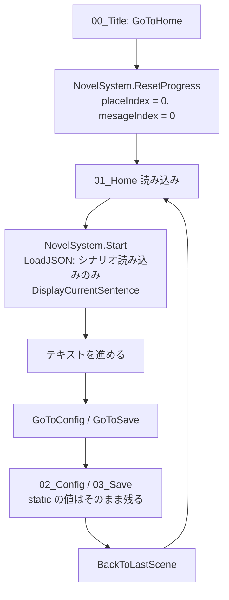
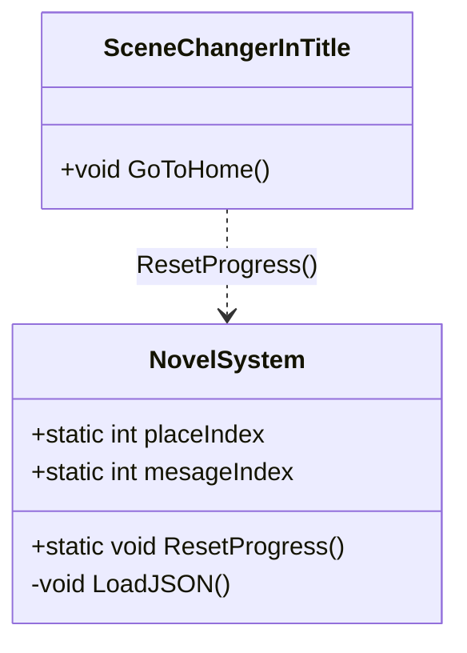

# 設計書：シーン遷移時のシナリオ進行状況の引き継ぎ

## 1. 概要
- 目的：01_Home → 02_Config（または 03_Save）→ 01_Home と戻ったときに、シナリオの続きから表示されるようにする
- 対象シーン：00_Title / 01_Home
- 原因：
  - `NovelSystem.placeIndex / mesageIndex` は static なので、シーンを切り替えても値は残っている
  - しかし `NovelSystem.Start()` → `LoadJSON()` の中で、**01_Home を開くたびに `placeIndex = 0; mesageIndex = 0;` で初期化している**ため、最初に戻ってしまう
- 方針：
  - 進行状況の初期化を `LoadJSON()` から外し、新しく作る `NovelSystem.ResetProgress()` にまとめる
  - 初期化はタイトルからゲームを始めるとき（`SceneChangerInTitle.GoToHome()`）だけ行う

## 2. 処理の流れ

## 3. クラス構成

## 4. 追加・変更一覧

### クラス
| 区分 | クラス名 | ファイル | 機能 |
|---|---|---|---|
| 変更 | `NovelSystem` | `Assets/Scripts/NovelSystem.cs` | 進行状況の初期化を別の関数に分ける |
| 変更 | `SceneChangerInTitle` | `Assets/AppMain/00_Title/Scripts/GotoHome.cs` | 01_Home へ移る前に進行状況を初期化する |

### 関数
| 区分 | クラス名 | 関数名（シグネチャ） | 機能 |
|---|---|---|---|
| 追加 | NovelSystem | `public static void ResetProgress()` | `placeIndex` と `mesageIndex` を 0 に戻す |
| 変更 | NovelSystem | `void LoadJSON()` | 先頭の `placeIndex = 0; mesageIndex = 0;` を削除する（シナリオの読み込みだけを行う） |
| 変更 | SceneChangerInTitle | `public void GoToHome()` | `NovelSystem.ResetProgress()` を呼んでから 01_Home を読み込む |

### 変数
| 区分 | クラス名 | 変数名 | 型 | 機能 |
|---|---|---|---|---|
| なし | | | | 既存の static 変数をそのまま使う |

### Unity 側の作業（シーン・プレハブ・Inspector 設定）
| シーン / オブジェクト | 作業内容 |
|---|---|
| なし | コードの変更だけで済む |

## 5. 懸念点・確認事項
1. 00_Title の **NEW GAME / CONFIG / LOAD GAME の 3 つのボタンがすべて `GoToHome()` を呼んでいる**。そのため、どのボタンから始めても進行状況は最初に戻る（ロード機能ができるまではこれで問題ない想定）
2. 03_Save から 01_Home に戻る場合も、同じ仕組みで続きから表示される
3. 01_Home を直接再生した場合は、static の初期値（0）から始まる
