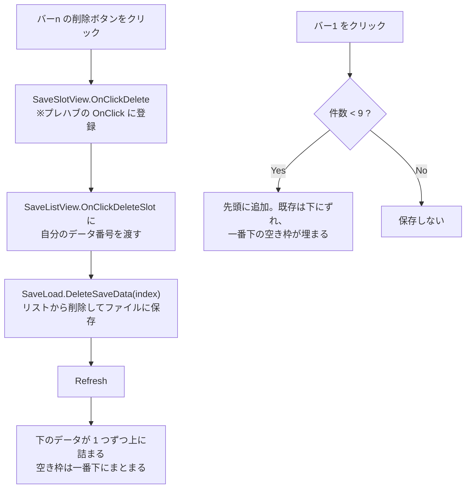
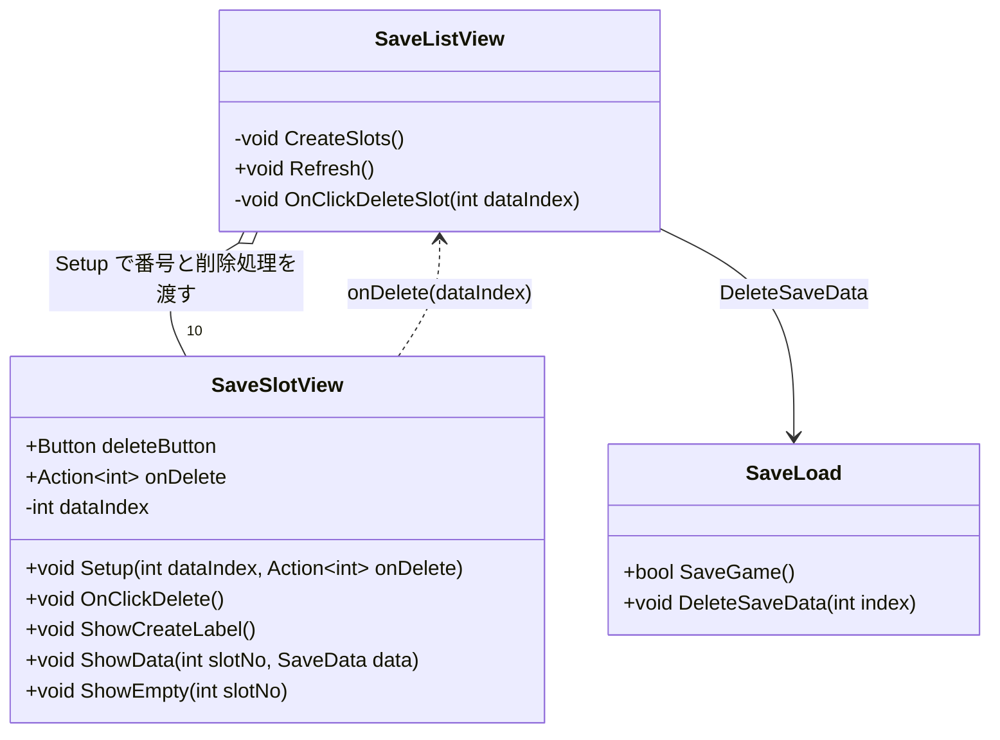

# 設計書：セーブデータの個別削除

## 1. 概要
- 目的：
  - 各セーブバー（バー 2〜10）に置いた削除ボタンで、そのバーのセーブデータだけを削除できるようにする
  - 削除で空いた枠があっても、新しいセーブデータが追加できるようにする
- 対象シーン：03_Save（プレハブ `SaveBar1.prefab`）
- 前提・制約：
  - 削除ボタンはユーザーがプレハブに配置する。スクリプトはそのボタンに紐づける関数を用意する
  - バーはスクリプトで生成するため、「どのバーの削除ボタンか」はスクリプト側でバーに番号を持たせて判別する
  - 新しいセーブは今と同じく「バー 2 に入り、既存のデータは下にずれる」。上限は 9 件のまま

## 2. 処理の流れ

### 動きの例（C, B, A の 3 件がある状態で B を削除してから D をセーブ）

| バー | 削除前 | B を削除 | D をセーブ |
|---|---|---|---|
| 2 | C | C | D |
| 3 | B | A | C |
| 4 | A | NO DATA | A |
| 5 | NO DATA | NO DATA | NO DATA |

## 3. クラス構成

## 4. 追加・変更一覧

### クラス
| 区分 | クラス名 | ファイル | 機能 |
|---|---|---|---|
| 変更 | `SaveSlotView` | `Assets/AppMain/03_Save/Scripts/SaveSlotView.cs` | 削除ボタンに紐づける関数を追加する。データの有無で削除ボタンの表示を切り替える |
| 変更 | `SaveListView` | `Assets/AppMain/03_Save/Scripts/SaveListView.cs` | 各バーに番号と削除処理を渡し、削除後に表示を更新する |
| 変更 | `SaveLoad` | `Assets/AppMain/03_Save/Scripts/Save.cs` | 指定した番号のセーブデータを削除する関数を追加する |

### 関数
| 区分 | クラス名 | 関数名（シグネチャ） | 機能 |
|---|---|---|---|
| 追加 | SaveSlotView | `public void Setup(int dataIndex, Action<int> onDelete)` | バーのデータ番号（バー2 = 0）と、削除時に呼ぶ処理を受け取る |
| 追加 | SaveSlotView | `public void OnClickDelete()` | **削除ボタンの OnClick に登録する関数**。`onDelete(dataIndex)` を呼ぶ |
| 変更 | SaveSlotView | `ShowCreateLabel()` / `ShowEmpty()` | 削除ボタンを非表示にする処理を追加する |
| 変更 | SaveSlotView | `ShowData()` | 削除ボタンを表示する処理を追加する |
| 変更 | SaveListView | `void CreateSlots()` | バー 2〜10 に `Setup(i - 1, OnClickDeleteSlot)` を呼ぶ |
| 追加 | SaveListView | `void OnClickDeleteSlot(int dataIndex)` | `saveLoad.DeleteSaveData(dataIndex)` を呼んで `Refresh()` する |
| 追加 | SaveLoad | `public void DeleteSaveData(int index)` | リストから index 番目を削除してファイルに保存する。範囲外の番号なら何もしない |

### 変数
| 区分 | クラス名 | 変数名 | 型 | 機能 |
|---|---|---|---|---|
| 追加 | SaveSlotView | `deleteButton` | `Button` | 削除ボタン（Inspector で設定）。表示・非表示の切り替えに使う |
| 追加 | SaveSlotView | `dataIndex` | `int` | このバーが表示しているデータの番号 |
| 追加 | SaveSlotView | `onDelete` | `Action<int>` | 削除ボタンが押されたときに呼ぶ処理 |

### Unity 側の作業（シーン・プレハブ・Inspector 設定）
| シーン / オブジェクト | 作業内容 |
|---|---|
| SaveBar1.prefab | プレハブを開き（ダブルクリック）、子に `Button - TextMeshPro` を追加して「削除」などのテキストにする。バーの右端などに配置する |
| SaveBar1.prefab / 削除ボタン | OnClick の「+」を押し、オブジェクト欄にプレハブのルート `SaveBar1` をドラッグして、`SaveSlotView > OnClickDelete` を選ぶ |
| SaveBar1.prefab / SaveSlotView | `Delete Button` 欄に追加した削除ボタンを設定する |

## 5. 懸念点・確認事項
1. **削除したあとの並び方**（案）
   - A：下のデータが上に詰まり、空き枠は一番下にまとまる ← 仮にこれで設計しています。新しいセーブは常にバー 2 に入るので、空き枠は必ず埋まります
   - B：削除した枠は空いたまま残る（他のデータは動かない）。新しいセーブはバー 2 に入り、その下のデータは**空き枠の手前まで**ずれて空き枠を埋める
2. 削除するときの確認ダイアログは作らない（押すとすぐ削除する）
3. 削除ボタンは、データがあるバーにだけ表示し、バー 1 と NO DATA のバーでは非表示にする
